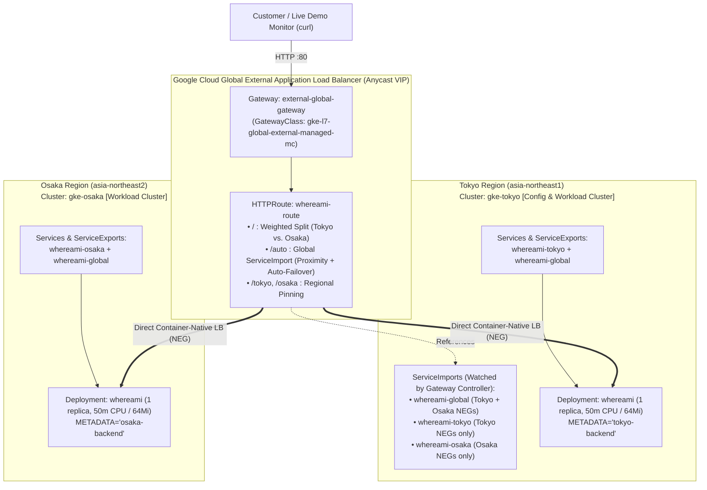

# GKE Multi-Cluster Gateway Active-Active Demo (Tokyo & Osaka)

This directory contains a complete, production-grade customer demonstration of **Google Kubernetes Engine (GKE) Multi-Cluster Gateway** (`gke-l7-global-external-managed-mc`) and **Multi-Cluster Services (MCS)** operating in an **Active-Active** topology across **Tokyo (`asia-northeast1`)** and **Osaka (`asia-northeast2`)** using the [`whereami`](https://github.com/GoogleCloudPlatform/kubernetes-engine-samples/tree/main/quickstarts/whereami) sample application.

---

## 1. Architecture Overview

A single Google Cloud **Global External Application Load Balancer** (GFEv3 anycast VIP) is provisioned by the GKE Multi-Cluster Gateway controller. It routes traffic directly to container-native Network Endpoint Groups (NEGs / Pod IPs) in both the **Tokyo** and **Osaka** GKE Autopilot clusters without extra cluster hops.



### Why Two Routing Patterns Are Included

To give customers a comprehensive demonstration in a single setup, both multi-cluster routing patterns are configured side by side on `whereami-route`:

| URL Path | Target `ServiceImport` | Routing & Failover Behavior | Primary Customer Use Case |
| :--- | :--- | :--- | :--- |
| **`/`** | `whereami-tokyo` + `whereami-osaka` | **Explicit Weighted Traffic Splitting** (`50:50`, `100:0`, `0:100`) controlled via `HTTPRoute.spec.rules[].backendRefs[].weight`. | Canary migrations, controlled regional traffic shifting, planned maintenance drain, or explicit 50/50 distribution regardless of client location. |
| **`/auto`** | `whereami-global` (Exported by both clusters) | **Automatic Proximity Routing & Zero-Touch Failover**. Cloud Load Balancing routes clients to the closest healthy region with capacity, and automatically fails over if one region loses all healthy Pods. | True Global Active-Active with automatic regional disaster recovery (no YAML changes required during an outage). |
| **`/tokyo`** | `whereami-tokyo` | Pinned 100% to Tokyo (`asia-northeast1`). | Direct regional health verification and smoke testing. |
| **`/osaka`** | `whereami-osaka` | Pinned 100% to Osaka (`asia-northeast2`). | Direct regional health verification and smoke testing. |

---

## 2. Key Technical Highlights & Corrections from Standard Single-Cluster YAML

1. **`ServiceImport` in `HTTPRoute.backendRefs`**:
   * GKE Multi-Cluster Gateways **do not support** standard `Service` resources in `backendRefs`. Every backend reference in `HTTPRoute` must explicitly specify `group: net.gke.io` and `kind: ServiceImport`:
     ```yaml
     backendRefs:
     - group: net.gke.io
       kind: ServiceImport
       name: whereami-tokyo
       port: 8080
       weight: 50
     ```
2. **Namespace Sameness**:
   * Multi-Cluster Services (MCS) group endpoints across clusters by matching both **Namespace name** (`whereami-demo`) and **Service name** (`whereami-global`).
3. **Fast Failover via `HealthCheckPolicy`**:
   * By default, Google Cloud Load Balancer health checks probe every `15s`. In [`manifests/03-gateway.yaml`](manifests/03-gateway.yaml), a `HealthCheckPolicy` (`networking.gke.io/v1`) is attached to each `ServiceImport` with `checkIntervalSec: 5`, `timeoutSec: 3`, and `unhealthyThreshold: 2` so regional failover occurs in **~10 seconds** during a live presentation.
4. **Control Plane Independence**:
   * Although `gke-tokyo` serves as the Fleet **Config Cluster** (where `Gateway` and `HTTPRoute` objects are applied), the data plane traffic flows directly from Google Front Ends (GFEs) to Pod IPs in Tokyo and Osaka. Even if pods in `gke-tokyo` go down, traffic continues flowing to `gke-osaka`.
5. **Minimal Cost GKE Autopilot Tuning (`50m` vCPU / `64Mi` Memory)**:
   * Both regional Deployments use `replicas: 1` and the minimum GKE Autopilot general-purpose resource requests (`cpu: 50m`, `memory: 64Mi`). Because Python/Flask cold start with `50m` vCPU takes ~25–35 seconds of wall-clock time, `livenessProbe.initialDelaySeconds` is set to `45` so kubelet does not prematurely restart the container during startup.
6. **Why Both Multi-Cluster Services (MCS) and Multi-Cluster Ingress Feature (`multiclusteringress`) Are Enabled**:
   * **Multi-Cluster Services (`multiclusterservicediscovery.googleapis.com`)**: Watches `ServiceExport` objects across member clusters and aggregates their container-native Network Endpoint Groups (NEGs) into `ServiceImport` objects on the Config Cluster.
   * **Multi-Cluster Ingress Feature (`multiclusteringress.googleapis.com` / `gcloud container fleet ingress enable`)**: Although Multi-Cluster Gateway is distinct from the legacy Multi-Cluster Ingress product, it shares the same Google-hosted Fleet feature flag and controller service agent (`service-<PROJECT_NUMBER>@gcp-sa-multiclusteringress.iam.gserviceaccount.com`). Enabling this feature designates `gke-tokyo` as the **Config Cluster**, automatically installs the multi-cluster `GatewayClass` resources (`gke-l7-global-external-managed-mc`, etc.), and authorizes the controller to program Global External Application Load Balancers across all Fleet member clusters.

---

## 3. Directory Structure

```text
gke-multicluster-gateway-demo/
├── Makefile                                       # One-command shortcuts for setup & live demo scenarios
├── README.md                                      # This documentation (English)
├── manifests/
│   ├── 00-namespace.yaml                          # Shared namespace (`whereami-demo`)
│   ├── 01-tokyo-workload.yaml                     # Tokyo Deployment (`METADATA=tokyo-backend`), Services & ServiceExports
│   ├── 02-osaka-workload.yaml                     # Osaka Deployment (`METADATA=osaka-backend`), Services & ServiceExports
│   ├── 03-gateway.yaml                            # Global Gateway (`gke-l7-global-external-managed-mc`) & HealthCheckPolicies
│   ├── 04-httproute-active-active-50-50.yaml      # Scenario 1: 50% Tokyo / 50% Osaka weighted split + `/auto` route
│   ├── 05-httproute-tokyo-100-osaka-0.yaml        # Scenario 2: 100% Tokyo / 0% Osaka weighted split
│   └── 06-httproute-tokyo-0-osaka-100.yaml        # Scenario 3: 0% Tokyo / 100% Osaka planned cutover
└── scripts/
    ├── 01-setup-infra.sh                          # Provisions VPC, GKE Autopilot clusters, Fleet, MCS, IAM & MCG
    ├── 02-deploy-workloads.sh                     # Deploys workloads, waits for ServiceImports & Gateway VIP
    ├── 03-live-demo-monitor.sh                    # Real-time colorized terminal dashboard for customer demos
    └── 99-cleanup.sh                              # Safe teardown script (prevents leaked GCLB resources)
```

---

## 4. Step-by-Step Setup Instructions

### Prerequisites

* Google Cloud SDK (`gcloud`) and `kubectl` installed
* `gke-gcloud-auth-plugin` installed
* A Google Cloud project with Billing enabled and Owner / Editor + Project IAM Admin permissions

### Step 1: Set Project ID and Provision Infrastructure

```bash
export PROJECT_ID="your-gcp-project-id"
make setup-infra
```

> **What this does**: Enables required APIs (`multiclusteringress`, `multiclusterservicediscovery`, `trafficdirector`, `gkehub`, `dns`), creates custom VPC `mcg-demo-vpc` with subnets in `asia-northeast1` and `asia-northeast2`, creates GKE Autopilot clusters `gke-tokyo` and `gke-osaka` in parallel, registers them to the Fleet, configures MCS and MCG IAM bindings, and verifies that the `gke-l7-global-external-managed-mc` `GatewayClass` is accepted on `gke-tokyo`.

### Step 2: Deploy Workloads, ServiceExports, and Multi-Cluster Gateway

```bash
make deploy-apps
```

> **What this does**: Applies `whereami-demo` namespace and `whereami` Deployments/Services/ServiceExports to `gke-tokyo` and `gke-osaka`, waits for `ServiceImport` objects (`whereami-global`, `whereami-tokyo`, `whereami-osaka`) to appear on `gke-tokyo`, and deploys the `external-global-gateway` and initial `whereami-route`.

Verify all resources are healthy:

```bash
make status
```

---

## 5. Running the Live Customer Demo (4 Scenarios)

Open **two terminal windows** side by side for the best customer presentation experience:
* **Terminal A (Top/Left)**: Run the live visual traffic monitor (`make monitor-weighted` or `make monitor-auto`).
* **Terminal B (Bottom/Right)**: Execute traffic shifts and failure simulations.

### Scenario A: Explicit 50:50 Active-Active Traffic Split across Tokyo & Osaka

Even when testing from a single client location (e.g., Tokyo office), weighted routing on `/` distributes requests across both Tokyo and Osaka according to the configured weights.

1. In **Terminal A**, start the live monitor on `/`:
   ```bash
   make monitor-weighted
   ```
2. In **Terminal B**, ensure the 50:50 route is active:
   ```bash
   make weight-50-50
   ```
3. **What the customer sees**: Responses alternate between `tokyo-backend` (`asia-northeast1`, blue) and `osaka-backend` (`asia-northeast2`, green), with the rolling progress bar stabilizing around `50% : 50%`.

### Scenario B: 100:0 Primary/Standby & 0:100 Planned Regional Cutover

Demonstrate zero-downtime traffic shifting between Tokyo and Osaka via declarative YAML updates.

1. While **Terminal A** continues running `make monitor-weighted`, run in **Terminal B**:
   ```bash
   # Pin 100% of traffic on `/` to Tokyo (0% to Osaka)
   make weight-100-0
   ```
2. Observe the monitor transition to `100% Tokyo (tokyo-backend) : 0% Osaka` within ~15-30 seconds of GCLB URL map propagation.
3. Next, perform a full regional cutover to Osaka:
   ```bash
   # Shift 100% of traffic on `/` to Osaka (0% to Tokyo)
   make weight-0-100
   ```
4. Observe traffic seamlessly move to `0% Tokyo : 100% Osaka (osaka-backend)` with zero dropped requests.

### Scenario C: Proximity-Based Global Routing & Automatic Regional Failover (`/auto`)

Demonstrate how a single `ServiceImport` (`whereami-global`) automatically routes users to their closest healthy region and fails over automatically without any human intervention or YAML modification when a region fails.

1. In **Terminal A**, switch the monitor to `/auto`:
   ```bash
   make monitor-auto
   ```
   *(If you are located in Tokyo, 100% of requests on `/auto` will naturally be served by `gke-tokyo` due to Google Cloud's proximity-based global load balancing).*
2. In **Terminal B**, simulate a complete regional application failure in Tokyo by scaling `whereami` replicas to `0`:
   ```bash
   make simulate-tokyo-outage
   ```
3. **What the customer sees**: Within ~10-15 seconds (thanks to our 5-second `HealthCheckPolicy`), Google Cloud Load Balancing detects that Tokyo endpoints are unhealthy/drained and **automatically shifts 100% of `/auto` traffic to Osaka (`osaka-backend`, `asia-northeast2`)** without touching `HTTPRoute`.
4. Restore Tokyo in **Terminal B**:
   ```bash
   make recover-tokyo
   ```
5. **What the customer sees**: Once the Tokyo Pods pass readiness and GCLB health checks, traffic on `/auto` automatically fails back to the closer Tokyo region.

### Scenario D: Direct Regional Pinning & Smoke Testing (`/tokyo` & `/osaka`)

Verify individual regional backends directly regardless of the active weighted split on `/` or client proximity on `/auto`:

```bash
GATEWAY_VIP="$(make get-vip)"

# Explicitly query Tokyo Pods (whereami-tokyo ServiceImport)
curl -s "http://${GATEWAY_VIP}/tokyo"

# Explicitly query Osaka Pods (whereami-osaka ServiceImport)
curl -s "http://${GATEWAY_VIP}/osaka"
```

---

## 6. Troubleshooting Common Issues

| Symptom | Root Cause | Resolution |
| :--- | :--- | :--- |
| `fault filter abort` or `HTTP 404/502` immediately after Gateway creation | GCLB backend NEGs and health checks are still initializing, or `HTTPRoute` references `Service` instead of `ServiceImport`. | Wait 1–2 minutes for backend health checks to turn `HEALTHY`. Verify `kubectl describe httproute whereami-route --context=gke-tokyo -n whereami-demo` shows `ResolvedRefs: True`. |
| `ServiceImport` objects do not appear on `gke-tokyo` | Missing `roles/compute.networkViewer` on `gke-mcs-importer` or MCS Service Agent role binding. | Re-run Step 5 of [`scripts/01-setup-infra.sh`](scripts/01-setup-infra.sh) and check `gcloud container fleet multi-cluster-services describe`. |
| `whereami` Pod restarts with `exitCode: 137` during cold start on Autopilot | With minimal `50m` vCPU requests, Python/Flask + GCE metadata initialization takes ~25–35s, exceeding short `livenessProbe` delays. | Keep `livenessProbe.initialDelaySeconds: 45` and `readinessProbe.initialDelaySeconds: 15` as configured in `01-tokyo-workload.yaml` and `02-osaka-workload.yaml`. |
| `gcloud projects add-iam-policy-binding` hangs waiting for input | The target project has existing IAM bindings with conditions, prompting interactively for a condition selection. | Pass `--condition=None` and set `CLOUDSDK_CORE_DISABLE_PROMPTS=1` (already included in [`scripts/01-setup-infra.sh`](scripts/01-setup-infra.sh)). |
| All backends show `UNHEALTHY` in Cloud Load Balancing | Custom VPC blocks Google Cloud health check IP ranges (`130.211.0.0/22`, `35.191.0.0/16`) on port `8080`. | Ensure firewall rule `mcg-demo-vpc-allow-gclb-health-checks` exists allowing ingress `tcp:8080` from `130.211.0.0/22,35.191.0.0/16`. |

---

## 7. Safe Cleanup

> **IMPORTANT**: Always delete `HTTPRoute` and `Gateway` resources on the Config Cluster **before** disabling Fleet Ingress or deleting the GKE clusters to avoid leaking Google Cloud Load Balancer forwarding rules and backend services.

```bash
# Delete K8s Gateway, HTTPRoute, ServiceExports, and disable Fleet features:
make cleanup

# Or also delete the GKE clusters and custom VPC network:
DELETE_INFRA=true ./scripts/99-cleanup.sh
```

---

## Links and References

### Customer-Sharable Public Resources
* [About multi-cluster Gateways | Google Kubernetes Engine (GKE)](https://cloud.google.com/kubernetes-engine/docs/concepts/multi-cluster-gateways)
* [Prepare your environment for multi-cluster Gateways | GKE Documentation](https://cloud.google.com/kubernetes-engine/docs/how-to/prepare-environment-multi-cluster-gateways)
* [Deploy an external multi-cluster Gateway | GKE Documentation](https://cloud.google.com/kubernetes-engine/docs/how-to/deploy-external-multi-cluster-gateway)
* [Deploy a multi-cluster Gateway for weighted traffic splitting | GKE Documentation](https://cloud.google.com/kubernetes-engine/docs/how-to/deploy-gateway-traffic-splitting)
* [Configure Gateway resources using Policies (HealthCheckPolicy & GCPBackendPolicy) | GKE Documentation](https://cloud.google.com/kubernetes-engine/docs/how-to/configure-gateway-resources)
* [Multi-cluster Services (MCS) Overview | GKE Documentation](https://cloud.google.com/kubernetes-engine/docs/concepts/multi-cluster-services)
